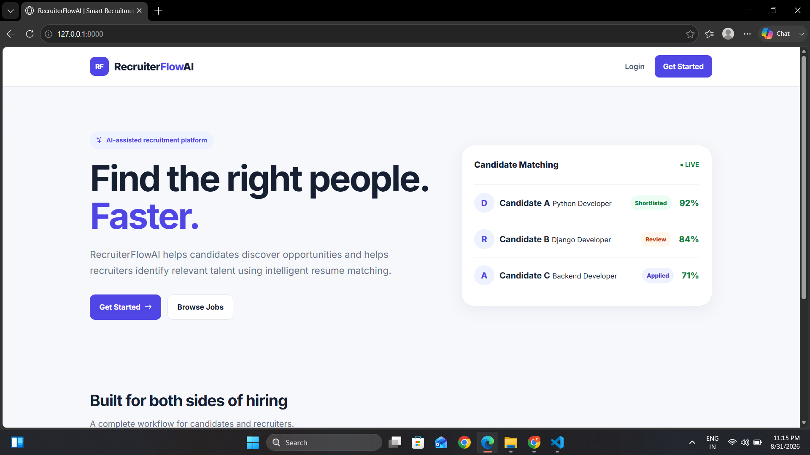
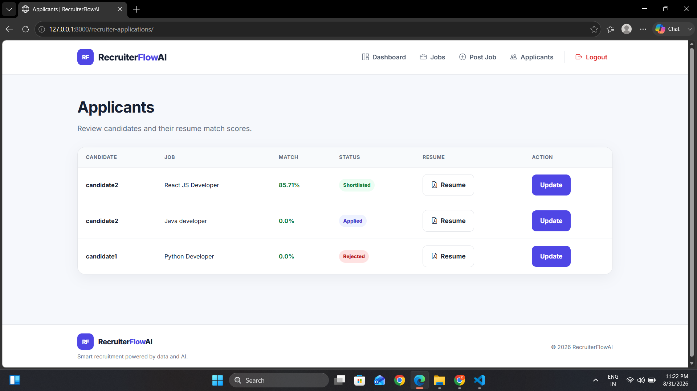
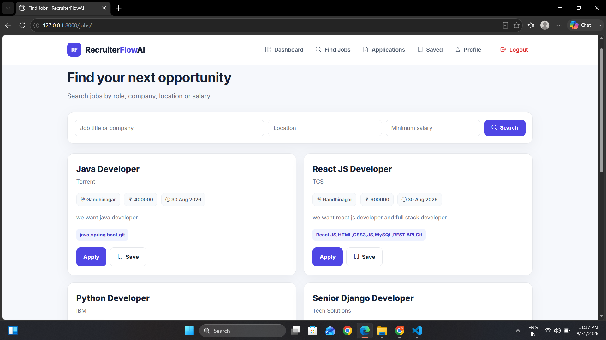
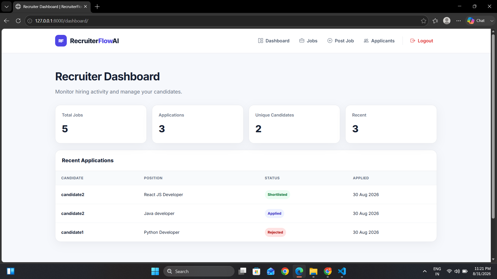
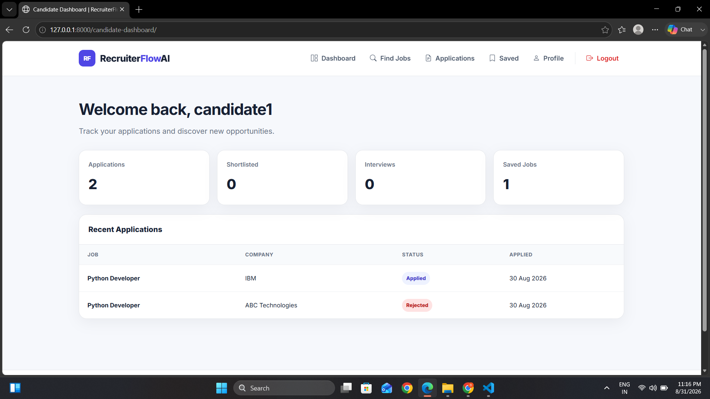

# 🚀 RecruiterFlowAI — AI-Assisted Recruitment Platform

[](https://www.python.org/)
[](https://www.djangoproject.com/)
[](https://www.django-rest-framework.org/)
[](https://ai.google.dev/)
[](/api/docs/)
[](LICENSE)

An intelligent, full-stack recruitment management platform built with **Django**, **Django REST Framework**, and **Google Gemini AI**. 

RecruiterFlowAI bridges the gap between job seekers and hiring teams through automated resume parsing, ATS skill extraction, and deep semantic matching to rank candidates with data-driven precision.

---

## 📑 Table of Contents

- [Key Highlights](#-key-highlights)
- [How the AI Matching Engine Works](#-how-the-ai-matching-engine-works)
- [Application Screenshots](#-application-screenshots)
- [Core Features](#-core-features)
- [System Architecture](#-system-architecture)
- [REST API & Interactive Documentation](#-rest-api--interactive-documentation)
- [Tech Stack](#-tech-stack)
- [Quick Start Guide](#-quick-start-guide)
- [Environment Variables](#-environment-variables)
- [Running Automated Tests](#-running-automated-tests)
- [Project Directory Structure](#-project-directory-structure)
- [Roadmap & Enhancements](#-roadmap--enhancements)
- [Author & Connect](#-author--connect)

---

## ✨ Key Highlights

- **🧠 Hybrid AI Candidate Scoring**: Evaluates applicants using a weighted model combining **70% semantic vector similarity** (via Google Gemini Embedding 2) and **30% deterministic ATS keyword matching**.
- **📄 Multi-Format Resume Parsing**: Automatically extracts and normalizes textual content from **PDF**, **DOCX**, and **TXT** files.
- **🛡️ Enterprise-Grade Role-Based Access Control**: Strict segregation between **Candidate** and **Recruiter** roles, preventing unauthorized access and privilege escalation.
- **⚡ Dual-Mode Semantic Engine**: High-accuracy Google Gemini API with automatic fallback to token-frequency cosine similarity if offline or unconfigured.
- **📚 Interactive OpenAPI 3.0 / Swagger Documentation**: Full REST API coverage with `drf-spectacular` and Swagger UI.
- **🎨 Modern, Responsive UI**: Clean interface built with semantic HTML5, modern CSS custom properties, and Bootstrap Icons.

---

## 🧠 How the AI Matching Engine Works

RecruiterFlowAI implements a **two-tier hybrid evaluation model**:

```
 Candidate Resume (PDF / DOCX) ──► Text Extractor (pypdf / XML parser)
                                              │
 ┌────────────────────────────────────────────┴───────────────────────────────────────────┐
 │                                                                                        │
 ▼                                                                                        ▼
[1] Deterministic Skill Matcher (30%)                                     [2] Semantic Vector Matcher (70%)
 • Extracts skills with punctuation & case normalization                  • Generates 768-dim embeddings via Google Gemini
 • Resolves skill aliases (e.g. 'js' ➔ 'javascript')                      • Computes high-dimensional cosine similarity
 • Profiles missing vs matched skills                                     • Robust fallback to token n-gram TF vectors
 │                                                                                        │
 └────────────────────────────────────────────┬───────────────────────────────────────────┘
                                              ▼
                                 [Hybrid Scoring Engine]
                  Final Score = (Semantic Score × 0.70) + (Skill Score × 0.30)
                                              ▼
                        Automated Candidate Tiering & Ranking
                  • Excellent Match (≥80%)    • Good Match (60-79%)
                  • Moderate Match (40-59%)   • Low Match (<40%)
```

### 1. ATS Explicit Skill Match (Weight: 30%)
- Identifies exact and alias-based skill matches from the candidate's resume and profile.
- Normalizes variations (e.g., `react.js`, `reactjs`, `react` ➔ `react`; `py` ➔ `python`).
- Generates exact lists of **Matched Skills** and **Missing Skills** for recruiter inspection.

### 2. Semantic Contextual Similarity (Weight: 70%)
- Sends structured resume and job description text to **Google Gemini Embedding 2**.
- Calculates vector cosine similarity:
  $$\text{Cosine Similarity} = \frac{\mathbf{A} \cdot \mathbf{B}}{\|\mathbf{A}\| \|\mathbf{B}\|}$$
- Captures subtle context (e.g., matching "distributed microservices architecture" with "backend scalability").

---

## 📸 Application Screenshots

### 1. Landing Page
Clean, modern entry point for candidates and recruiters.


### 2. AI Candidate Match & Recruiter Review
Detailed AI score breakdown, matched vs. missing skills, and status management.


### 3. Job Search & Discovery
Keyword, location, and salary filtering with live application status tags.


### 4. Recruiter Dashboard
Real-time metrics on postings, active applicants, and candidate tracking.


### 5. Candidate Dashboard
Track application progression through stages (Applied, Under Review, Shortlisted, Interview).


---

## 🎯 Core Features

### For Candidates
- 👤 **Profile Management**: Upload profile photos, resumes, and showcase skills and education.
- 🔍 **Smart Job Search**: Filter positions by title, company, location, and minimum salary.
- 🔖 **Bookmark Jobs**: Save positions for later consideration.
- 📤 **One-Click Application**: Submit customized cover letters and resumes.
- 📊 **Status Tracker**: Track progress across hiring stages (Applied ➔ Under Review ➔ Shortlisted ➔ Interview ➔ Selected / Rejected).

### For Recruiters
- ✍️ **Job Posting Management**: Create, edit, and delete job openings with custom skill criteria.
- 🤖 **Automated Candidate Ranking**: Review applicants ordered by AI match percentage.
- 📋 **Detailed Applicant Breakdown**: Inspect semantic match %, skill match %, matched badges, missing skills, and attached resume.
- 🔄 **One-Click Recalculation**: Re-run AI analysis if candidate profiles or resumes change.
- 📈 **Recruiter Analytics**: Overview of total postings, applicants, and recent submissions.

---

## 🔌 REST API & Interactive Documentation

RecruiterFlowAI includes a REST API powered by **Django REST Framework** and OpenAPI 3.0 specification.

Access the interactive **Swagger UI** in your browser at:
```
http://127.0.0.1:8000/api/docs/
```

### API Endpoints Summary

| Method | Endpoint | Description | Permissions |
|:-------|:---------|:------------|:------------|
| `GET` | `/api/` | API root discovery | Public |
| `GET` | `/api/jobs/` | List all available jobs | Authenticated |
| `POST` | `/api/jobs/` | Create a new job posting | Recruiter |
| `GET` | `/api/jobs/<id>/` | Retrieve job details | Authenticated |
| `PUT` | `/api/jobs/<id>/` | Update job posting | Job Owner (Recruiter) |
| `DELETE` | `/api/jobs/<id>/` | Delete job posting | Job Owner (Recruiter) |
| `GET` | `/api/applications/` | List current candidate's applications | Candidate |
| `POST` | `/api/applications/` | Apply for a job (triggers AI matching) | Candidate |
| `GET` | `/api/recruiter-applications/` | List applicants for recruiter's jobs | Recruiter |
| `GET` | `/api/applications/<id>/` | Retrieve detailed application & scores | Owner / Recruiter |
| `PATCH` | `/api/applications/<id>/` | Update applicant status | Recruiter |
| `POST` | `/api/applications/<id>/recalculate/`| Recompute AI scores via API | Recruiter |
| `GET` | `/api/schema/` | OpenAPI 3.0 YAML/JSON schema | Public |
| `GET` | `/api/docs/` | Interactive Swagger UI | Public |

---

## 🛠️ Tech Stack

| Category | Technologies |
|:---------|:-------------|
| **Backend** | Python 3.11+, Django 5.1+ / 6.0, Django REST Framework |
| **Artificial Intelligence** | Google Gemini Embedding 2 (`google-genai`), Vector Cosine Math |
| **API Documentation** | OpenAPI 3.0, `drf-spectacular`, Swagger UI |
| **Database** | SQLite (Development) / PostgreSQL compatible |
| **Document Parsing** | `pypdf`, native OpenXML DOCX engine |
| **Frontend** | Django Templates, Modern CSS3 Flexbox/Grid, Bootstrap Icons |
| **Environment & Config** | `python-dotenv` |

---

## 🚀 Quick Start Guide

### Prerequisites
- Python 3.11 or higher
- Git

### 1. Clone the Repository
```bash
git clone https://github.com/<your-username>/RecruiterFlowAI.git
cd RecruiterFlowAI
```

### 2. Create and Activate Virtual Environment
```bash
# Windows
python -m venv venv
venv\Scripts\activate

# macOS / Linux
python3 -m venv venv
source venv/bin/activate
```

### 3. Install Dependencies
```bash
pip install -r requirements.txt
```

### 4. Configure Environment Variables
Copy the `.env.example` file to `.env`:
```bash
# Windows
copy .env.example .env

# macOS / Linux
cp .env.example .env
```

Edit `.env` and add your keys:
```env
SECRET_KEY=your-django-secret-key
DEBUG=True
ALLOWED_HOSTS=127.0.0.1,localhost
GEMINI_API_KEY=your_gemini_api_key_here
```
> 💡 *Note: A Gemini API key can be generated for free at [Google AI Studio](https://aistudio.google.com/app/apikey). If left empty, the application automatically uses the built-in offline NLP fallback.*

### 5. Run Database Migrations
```bash
python manage.py migrate
```

### 6. Create a Superuser (Optional)
```bash
python manage.py createsuperuser
```

### 7. Start Development Server
```bash
python manage.py runserver
```
Visit `http://127.0.0.1:8000/` in your browser.

---

## 🧪 Running Automated Tests

RecruiterFlowAI includes automated unit and integration tests covering role authorization, application workflows, AI matching, and skill normalization:

```bash
python manage.py test
```

Expected output:
```
Ran 15 tests in ...s
OK
System check identified no issues (0 silenced).
```

---

## 📁 Project Directory Structure

```
RecruiterFlowAI/
├── RecuiterFlowAI/         # Project configuration & settings
│   ├── settings.py         # Django settings, DRF & Spectacular config
│   ├── urls.py             # Root URL routing
│   └── wsgi.py             # WSGI entry point
├── accounts/               # User authentication & role management
│   ├── models.py           # Custom User (Candidate/Recruiter), CandidateProfile
│   ├── views.py            # Login, register, profile management
│   └── forms.py            # User creation & profile forms
├── jobs/                   # Job listings and management
│   ├── models.py           # Job model with skill helper methods
│   ├── views.py            # Job CRUD, search & pagination
│   └── forms.py            # Job posting validation form
├── applications/           # Core AI & application workflow
│   ├── ai_matcher.py       # Gemini embeddings & cosine similarity engine
│   ├── skill_matcher.py    # Explicit ATS skill & alias normalization
│   ├── resume_parser.py    # Multi-format PDF/DOCX/TXT text extractor
│   ├── matching_service.py # Hybrid scoring evaluation service
│   ├── models.py           # Application & SavedJob models
│   └── views.py            # Apply, recruiter dashboard, detail review
├── api/                    # Django REST Framework endpoints
│   ├── views.py            # APIViews for Jobs, Applications & Recalculate
│   ├── serializers.py      # Serializers with exposed AI metrics
│   ├── permissions.py      # Role-based DRF permissions
│   └── urls.py             # REST API routes
├── templates/              # Semantic HTML5 templates
│   ├── base.html           # Master layout with role-aware navigation
│   ├── accounts/           # Auth & profile templates
│   ├── jobs/               # Job search & listing views
│   └── applications/       # AI analysis, dashboard & application views
├── static/css/             # Responsive stylesheets
├── screenshots/            # UI screenshots for documentation
├── requirements.txt        # Production dependencies
├── .env.example            # Environment variables template
└── README.md               # Project documentation
```

---

## 🗺️ Roadmap & Future Enhancements

- [ ] Automated interview question generator based on candidate skill gaps
- [ ] Automated email notifications for application status updates
- [ ] Export applicant rankings to CSV / PDF reports
- [ ] Multi-tenant support for recruitment agencies
- [ ] Docker containerization & Docker Compose setup

---

## 🤝 Author & Connect

Developed by **Divya Patani**  
- **GitHub**: [github.com/patanidivya31](https://github.com/patanidivya31)  
- **LinkedIn**: [linkedin.com/in/divyapatani](https://www.linkedin.com/)  
- **Email**: `patanidivya31@gmail.com`

---

⭐ **If you found this project helpful or inspiring, please give it a star on GitHub!**